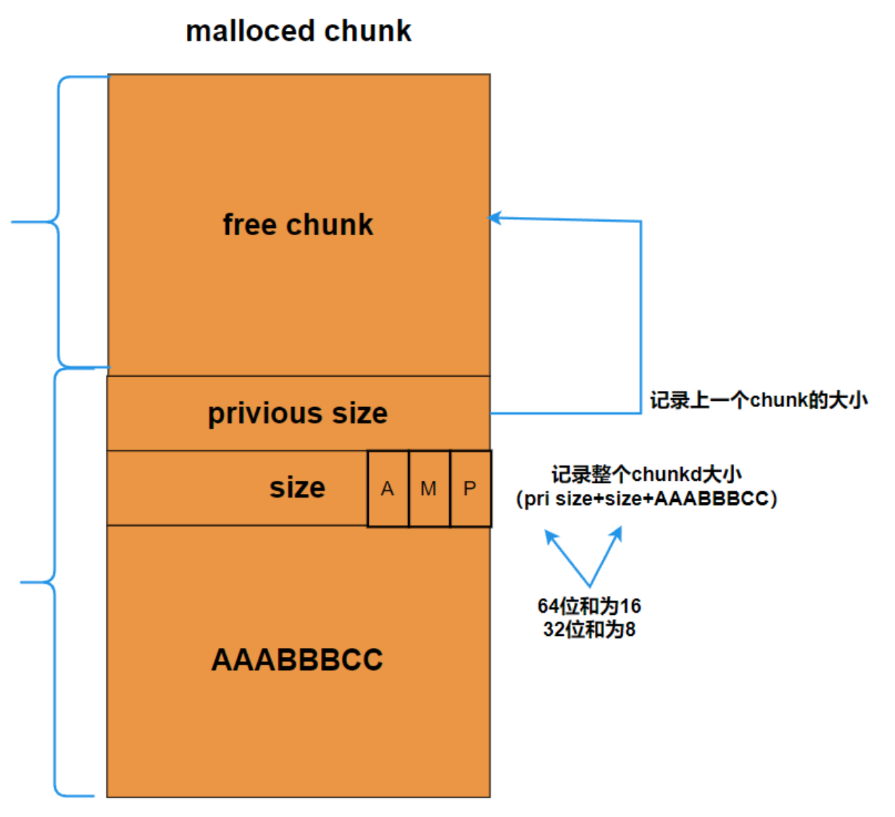
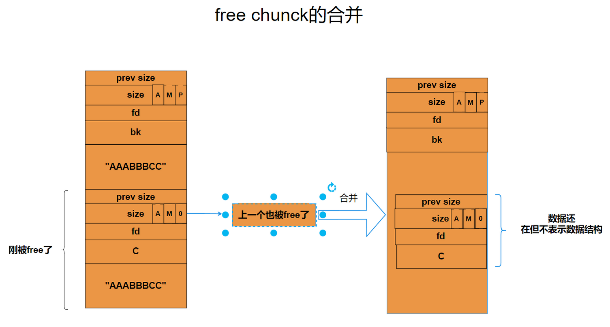
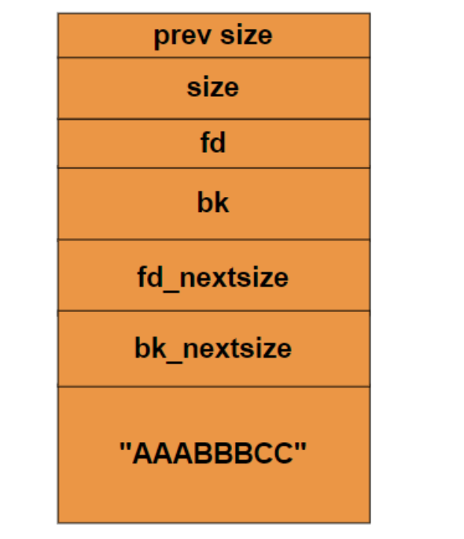
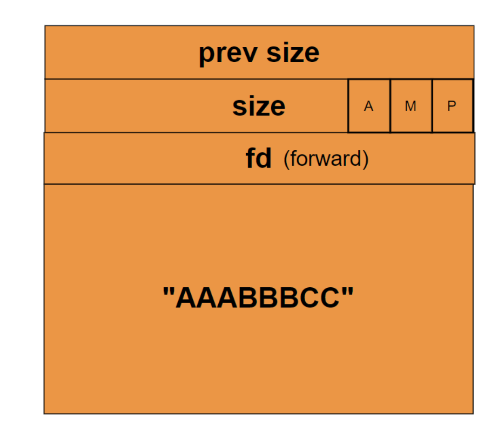
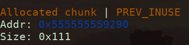

## glibc堆的概念

堆是程序虚拟内存中由低地址向高地址增长的线性区域，出于效率和页对齐的考虑，通常会分配相当大的连续内存。程序再次申请时便会从这片内存中分配，直到堆空间不能满足时才会再次增长

 堆的属性是可读可写，大小通过brk（）和sbrk（） 控制 

在堆未初始化时，program_break指向BSS段的末尾，通过调用brk()和sbrk()来移动program_break使得堆增长

在堆未初始化时，若 开启 ASLR，则堆的起始地址start_brk在BSS段随机位移处，若未开启，则紧邻BSS段

## 堆内存分配相关函数

#### malloc()、realloc()、calloc()、free()

**malloc()：动态内存分配，但不清除开辟的内存中的数据**

```c
void* malloc(size_t size);
```

- **`size`**: 需要分配的内存大小，单位是**字节 (bytes)**
- **返回值**:
  - 如果分配成功，返回一个指向所分配内存块起始地址的 `void*` 类型指针
  - 如果分配失败（例如内存不足），则返回 `NULL`

**realloc()：调整已分配动态内存大小**

```c
void* realloc(void* ptr, size_t size);
```

**`ptr`**: 指向需要调整大小的原有内存块的指针。这个指针必须是由 `malloc`、`calloc` 或 `realloc` 之前分配的。如果传入 `NULL`，`realloc` 的行为就等同于 `malloc(size)`

**`size`**: 调整后的新内存大小，单位是**字节 (bytes)**

**返回值**:
- 成功，返回一个指向调整后内存块起始地址的指针
- 失败，返回 `NULL`，**并且原有的内存块不会被改变或释放**

**calloc()：动态内存分配，并且将所分配的堆块用户数据中重置**

```c
void* calloc(size_t num, size_t size);
```

- `num`: 要分配的元素个数

- `size`: 每个元素的大小（以字节为单位）

**返回值**:

- 成功，返回一个指向已分配内存块起始地址的 `void*` 类型指针
- 失败，返回 `NULL`

**free()：释放动态分配内存**

```c
void free(void *ptr);
```

`ptr` 是指向要释放内存的指针。这个指针必须是之前由 `malloc`、`calloc` 或 `realloc` 成功分配并返回的

**返回值**：无（`void`）

**底层原理**

当你调用 `free(ptr)` 时，底层（通常是 glibc 的内存分配器）会发生以下事情：

1. **定位头部**：分配器会根据 `ptr` 的地址，向前推算出这块内存的**头部信息（Chunk Header）**。这个头部记录了内存块的大小和状态
2. **标记空闲**：将该内存块的状态标记为“空闲（Free）”
3. **归还与合并**：
   - 这块内存并没有真正“消失”，而是被放回了**空闲链表**中，等待下一次 `malloc` 或 `calloc` 再次使用
   - 为了防止内存碎片，分配器通常会检查这块内存的前后是否有相邻的空闲块。如果有，它会将它们**合并**成一个更大的空闲块
4. **数据残留**：`free` **不会**擦除内存中的数据。那块内存里的值可能还在，直到被下一次分配覆盖。因此，访问已释放的内存是极度危险的

> 当你在程序中调用 `malloc(size)` 时，glibc 的查找顺序通常是：
>
> 1. **Tcache** (无锁，最快)
> 2. **Fastbins** (有锁)
> 3. **Small Bins**
> 4. **Unsorted Bin** (在此过程中可能会整理并放入 Small/Large Bins)
> 5. **Large Bins**
> 6. **Top Chunk** (Arena 尾部的剩余空间)
> 7. **System Calls** (如果 Top Chunk 也不够，则调用 `sbrk` 扩容或 `mmap` 分配)

------

#### brk()和sbrk()

`brk` 和 `sbrk` 的核心作用是改变"program break"（程序间断点）的位置，即进程数据段的结尾。程序间断点是未初始化数据段之后的首个位置，通过调整这个指针可以实现堆空间的扩展或收缩

**brk()**：直接将程序间断点设置为指定地址

```c
int brk(void *addr);
```

- **返回值**
  - 成功，返回0
  - 失败，返回-1并设置errno为ENOMEM

- 用于精确控制堆顶位置或释放内存

**sbrk()**：通过增量方式移动程序间断点

```c
void *sbrk(intptr_t increment);
```

- **返回值**

  - 成功，返回移动前的程序间断点地址

  - 失败，返回(void *)-1


`increment`

- **increment > 0**：分配内存（向高地址移动）

- **increment < 0**：释放内存（向低地址移动）

- **increment = 0**：仅返回当前堆顶地址

------

#### mmap()和munmap()

> 当用户通过malloc手动分配的堆内存大小超过malloc的内存分配阈值**`M_MMAP_THRESHOLD`**时（其默认值通常为128KB），但是mmap分配的是内存映射区的内存

`mmap` 和 `munmap` 是Linux/Unix 系统编程中用于内存管理的两个核心系统调用。主要功能是在进程的虚拟地址空间与文件或其他对象之间建立和解除映射关系

简单来说，`mmap` 允许你将一个文件直接“映射”到进程的内存地址空间，之后就可以像操作普通内存一样通过指针来读取文件内容，而无需使用传统的 `read` / `write` 系统调用。`munmap` 则负责在不再需要时，接触这种映射关系，释放资源

**mmap()**：创建一个新的内存映射

```c
#include <sys/mman.h>

void *mmap(void *addr, size_t length, int prot, int flags,int fd, off_t offset);
```

- **`addr`**: 建议的映射起始地址。通常设置为 `NULL`，让内核自动选择一个合适的地址

- **`length`**: 要映射的字节数。实际映射的大小会是系统页大小（通常为4KB）的整数倍
- **`prot`**: 指定映射区域的访问权限，可以使用位或运算符 `|` 组合以下值：
  - `PROT_READ`: 页面可读
  - `PROT_WRITE`: 页面可写
  - `PROT_EXEC`: 页面可执行
  - `PROT_NONE`: 页面不可访问
- **`flags`**: 控制映射的类型和行为，常用标志包括：
  - `MAP_SHARED`: **共享映射**。对映射区域的修改会同步回底层文件，并且对其他映射了同一文件的进程可见。常用于进程间通信（IPC）和文件的高效写入
  - `MAP_PRIVATE`: **私有映射**。对映射区域的修改不会写回文件，而是触发“写时复制”（Copy-on-Write）机制，创建一个私有的副本。常用于加载程序代码或只读数据
  - `MAP_ANONYMOUS`: **匿名映射**。映射区域不与任何文件关联，初始化为零。此时 `fd` 参数应设为 -1。常用于分配大块内存
- **`fd`**: 要映射的文件的文件描述符。如果是匿名映射（`MAP_ANONYMOUS`），则设为 -1
- **`offset`**: 从文件开头算起的偏移量，必须是系统页大小的整数倍

- **返回值**
  - 成功，返回指向映射区域起始地址的指针
  - 失败，返回 `MAP_FAILED`（即 `(void *)-1`），并设置 `errno` 以指示错误原因


**munmap()**：解除内存映射

```c
#include <sys/mman.h>

int munmap(void *addr, size_t length);
```

- **`addr`**: 要解除映射的区域的起始地址，即 `mmap` 调用成功时返回的指针
- **`length`**: 要解除映射的字节数

- **返回值**
  - 成功，返回 0
  - 失败，返回 -1，并设置 `errno`

## glibc堆的相关结构

### Chunk 结构

堆内存所接触到的最常见的结构，也是堆内存管理的最小单位。`malloc_chunk` 结构体巧妙地通过内存复用技术，使得同一个结构体在内存块被分配（使用）和释放（空闲）时呈现出不同的形态，以兼顾性能和功能。

以下是 `malloc_chunk` 在 `glibc` 源码中的定义：

```c
struct malloc_chunk {
  INTERNAL_SIZE_T      prev_size;  /* 前一个 chunk 的大小 (仅当前一个 chunk 空闲时有效) */
  INTERNAL_SIZE_T      size;       /* 当前 chunk 的大小，包含头部开销 */
  struct malloc_chunk* fd;         /* 前向指针，仅在 chunk 空闲时使用 */
  struct malloc_chunk* bk;         /* 后向指针，仅在 chunk 空闲时使用 */
  struct malloc_chunk* fd_nextsize;/* 下一个不同大小的空闲 chunk，仅用于 large bins */
  struct malloc_chunk* bk_nextsize;/* 上一个不同大小的空闲 chunk，仅用于 large bins */
};
```

其中，`INTERNAL_SIZE_T` 通常等同于 `size_t`，在 64 位系统上为 8 字节，32 位系统上为 4 字节

- **`mchunk_size`**：记录当前 Chunk 的总大小（包含头部）。其最低的三个比特位被用作标志位：
  - **A (NON_MAIN_ARENA)**：表示当前 Chunk 是否属于非主 Arena
  - **M (IS_MMAPPED)**：表示当前 Chunk 是否由 `mmap` 分配
  - **P (PREV_INUSE)**：表示前一个 Chunk 是否正在被使用
- **`fd` 和 `bk`**：这两个指针只在 Chunk 处于空闲状态时才有效，用于将其链接到对应 Bin 的双向链表中

**Chunk 的类型**

根据其在内存管理中的角色，Chunk 可分为：

- **Allocated chunk**：已分配给用户且未被释放的内存块
- **Free chunk**：用户已释放，正被 glibc 管理在某个 Bin 中的空闲内存块
- **Top chunk**：位于 Arena 内存区域最顶端的 Chunk，是最后一个 Chunk。当所有 Bin 中都没有合适的空闲块时，分配器会从 Top chunk 中切分内存。如果 Top chunk 空间不足，则会通过系统调用扩展它

> 以下借用CSDN的一个博主的图片来理解堆块的各种状态


#### Allocated chunk



`privious size`：记录前一个 chunk 的大小 (仅当前一个 chunk 空闲时有效)，用于free时的合并空闲堆块

`size`：记录当前堆块的大小

> 当前一个chunk在使用状态时，该chunk的size将表示为申请的内存大小 + 0x1，这个0x1表示的是P标志位，当前 chunk 的 P 位反映的是物理相邻的前一个 chunk 的状态。

#### Free chunk



#### large bin free chunk



#### fast bin free chunk




### Bins 结构

**Bins** 是指分配器内部维护的**整个数组结构**，用来管理所有不同类型的 bin。在 `glibc` 中，通常维护着一个包含 **128 个 bin** 的数组。

在源码中，Bins 并不是一个统一的数组，而是分为两个主要部分：

- **`fastbinsY` 数组**：专门用于存放 Fast Bins。

- **`bins` 数组**：存放 Unsorted Bin、Small Bins 和 Large Bins。

```c
struct malloc_state {
    /* ... 其他字段 ... */
    mfastbinptr fastbinsY[NFASTBINS]; // Fast Bins 数组
    mchunkptr bins[NBINS * 2 - 2];    // 其他类型的 Bins 数组
    /* ... 其他字段 ... */
};
```

------

#### **fast bin**

Fast bin 是 `glibc malloc` 中为了提高小内存块分配和释放效率而设计的一种快速缓冲区。它本质上是一系列**单向链表**，专门处理频繁使用的小型内存请求。它的核心思想是：**通过推迟合并（Coalescing）并使用 LIFO（后进先出）算法，最大限度地减少操作开销。**

**核心特性**

- **大小范围**：在 64 位系统下，通常覆盖 **32 字节到 160 字节** 的 chunk（以 16 字节递增）。
- **LIFO 机制**：后进先出（Last-In, First-Out）。最后释放的 chunk 会最先被分配出去。
- **不合并（No Coalescing）**：这是 Fastbin 最显著的特点。为了速度，当一个 chunk 进入 Fastbin 时，它的 `PREV_INUSE` 位不会被清除，`malloc` 也不会将其与相邻的空闲 chunk 合并。
- **单向链表**：Chunk 仅通过 `fd` 指针连接，不使用 `bk` 指针。

**工作机制**

在 `malloc_state`（即主分配区的 `main_arena`）中，有一个 `fastbinsY` 数组，该数组一共有10个索引，每个索引存放对应大小链表的表头指针。

| 操作              | 逻辑描述                                                     |
| ----------------- | ------------------------------------------------------------ |
| **释放 (free)**   | 如果 chunk 大小符合 Fastbin，它会被直接插入到对应链表的**头部**。 |
| **分配 (malloc)** | 如果申请的大小匹配 Fastbin，`malloc` 直接从链表**头部**取出一个 chunk。如果该链表为空，则去寻找更高级别的 bin。 |

> **漏洞利用**：
>
> 由于 Fastbins 是极简的单向链表，它缺乏复杂的校验机制，这导致了著名的安全隐患：
>
> 1. **Fastbin Double Free**
> 2. **Fastbin Attack (Fake Chunk)**
> 3. **House of Spirit**

------

#### **small bin**

small bin 是 处理“小块"内存申请的核心结构，目标是在**内存碎片控制**与**分配速度**之间取得平衡。

**核心特性**

- **范围**：管理小于 1024 字节（64位系统）的空闲 Chunk。

- **数量**：总共有 **62 个** Small Bin。

- **等尺寸（Fixed Size）**：每个 Small Bin 链表中的 Chunk 大小都是**完全一致**的。

  - 索引从 2 到 63。

  - 最小的 Small Bin 大小为 32 字节（即 2×2×size_t），步长为 16 字节。

  - 计算公式通常为：Size=Index×16。

- **排序机制**：采用 **FIFO（先进先出）** 算法。
- **双向链表**：Chunk 通过 `fd` `bk` 指针进行连接。

------

#### **large bin**

Large Bin 是负责处理“大块”内存申请的核心结构。当请求的内存大小超过了 Small Bin 的上限（通常是 1024 字节）时，Large Bin 就开始发挥作用了。

不同于 Fast Bin 和 Small Bin，Large Bin 的设计重点在于**空间效率**和**灵活性**，而非极致的响应速度。

**核心特性**

- **范围**：管理**大于等于 1024 字节**（在 64 位系统上）的空闲内存块（Chunk）。

- **数量**：总共有 **63 个** Large Bin。

- **分级管理**：

  - 第 1 组：前 32 个 Bin：步长为 64 字节。

  - 第 2 组：接16 个 Bin：步长为 512 字节。

  - 第 3 组：接 8 个 Bin：步长为 4096 字节。
  - 第 4 组：接 4 个 Bin：步长为 32768 字节。
  - 第 5 组：接 2 个 Bin：步长为 262144 字节。

  - 第 6 组：接 1 个 Bin：步长不限制。

- **排序机制**：同一个 Large Bin 中的 Chunk 按**大小降序**排列；如果大小相同，则按**内存地址从高到低**排列。

**数据结构**

Large Bin 的 Chunk 拥有最复杂的结构，因为它需要支持双向链表的操作以及快速的跳跃查找：

- **`fd` / `bk`**：标准双向链表指针，指向物理相邻或逻辑相邻的空闲 Chunk。

**`fd_nextsize` / `bk_nextsize`**：这是 Large Bin 特有的指针。

- 由于一个 Bin 里可能包含不同大小的 Chunk，这两个指针用于在**不同大小的堆块**之间跳转。
- 这使得分配器可以快速跳过大量不符合尺寸要求的 Chunk，极大地提高了在大块内存中搜索的效率。

> **漏洞利用：**
>
> **任意地址写入（Large Bin Attack）**

------

#### **unsorted bin**

Unsorted Bin 是 `glibc malloc` 中最独特的 Bin，它充当了堆内存回收的**第一站缓冲区**。与 Fastbin 或 Small Bin 不同，它不按大小分类，而是将各种大小的空闲 chunk 混合存放。

**核心特性**

- **角色**：它是内存回收的“中转站”。当一个 chunk 被释放（且不属于 Fastbin 范围，或 Fastbin 发生合并时），它首先被放入 Unsorted Bin，而不是立即回到对应的 Small/Large Bin。
- **结构**：**双向循环链表**（Doubly Linked List）。它使用 `fd`（forward）和 `bk`（backward）指针。
- **位置**：在 `malloc_state` (arena) 的 `bins` 数组中，Unsorted Bin 占据 **index 1** 的位置。

**工作机制**

Unsorted Bin 的存在是为了**给最近释放的内存第二次机会**，从而提高缓存局部性。

**释放时 (Freeing)**

当一个 chunk 被 `free()` 且满足以下条件之一时，它会进入 Unsorted Bin：

1. 大小超过 Fastbin 的限制。
2. 与 Top Chunk 不相邻（否则会直接合并到 Top Chunk）。
3. 当触发 `malloc_consolidate`（如申请大内存导致 Fastbin 合并）时，合并后的 chunk 也会进入这里。

**分配时 (Allocating)**

这是 Unsorted Bin 最繁忙的时候：

1. **遍历逻辑**：当 `malloc` 在 Fastbin 和 Small Bin 中找不到匹配的 chunk 时，它会开始**清空** Unsorted Bin。
2. **精确匹配**：如果在遍历过程中发现一个 chunk 的大小刚好符合请求，则直接分配。
3. **整理归类**：如果大小不匹配，`malloc` 会把这个 chunk 从 Unsorted Bin 中取出，根据其大小将其扔进对应的 **Small Bin** 或 **Large Bin**。
4. **整理直到空**：这个过程会一直持续，直到 Unsorted Bin 变为空，或者找到了合适的 chunk：

> **漏洞利用**：
>
> 在堆利用中，Unsorted Bin 是获取 **Libc 基地址** 和实现 **Unsorted Bin Attack** 的核心。
>
> 1. **泄露 Libc 基地址 (Leak Libc)**
> 2. **Unsorted Bin Attack (任意地址写)**
> 3. **Overlap / Off-by-one**


### Top Chunk

Top Chunk 位于分配区（Arena）的最顶部，它是堆中**最后一块**可用的连续空闲内存。

- **唯一性**：每个 Arena 只有一个 Top Chunk。
- **非 Bin 约束**：它不属于任何 Bin（如 fastbins, small bins 等）。
- **动态性**：随着内存的分配，它的地址会向高地址推移，大小随之减小；随着内存的释放（如果是紧邻 Top Chunk 的内存），它会吸收这些内存并变大。

**结构特征**

Top Chunk 的结构与普通的 Chunk 基本一致，但有几个关键点：

- **Size 字段**：记录了当前 Top Chunk 剩余的总大小。
- **PREV_INUSE (P位)**：Top Chunk 的 P 位始终为 **1**。因为如果它前面的 Chunk 是空闲的，那个 Chunk 早就和 Top Chunk 合并了。
- **Fencepost（篱笆桩）**：它的 `fd` 和 `bk` 指针通常不指向 Bin 链表，而是用于内部边界判定。

**内存回收机制**

Top Chunk 负责将内存“还”给操作系统：

- **合并（Coalescing）**：当用户 `free` 一块内存时，如果这块内存物理上紧邻 Top Chunk，它们会自动合并成一个新的、更大的 Top Chunk。
- **收缩（Trimming）**：当 Top Chunk 变得非常大（超过了 `M_TRIM_THRESHOLD` 阈值，默认通常是 128KB），ptmalloc 会调用 `sbrk` 或 `madvise` 将多余的内存归还给内核，以降低进程的 RSS（驻留集大小）。

> **漏洞利用**：
>
> **House of Force**

### Arena 结构

`ptmalloc2` 中，`arena` 是核心的管理单元，该结构管理着一片连续的heap内存，可以把 `arena` 理解为一个"内存池"，主要作用是管理一大块从操作系统申请来的连续内存（Heap），并维护这些内存中空闲块（Free Chunks）的链表，以便快速分配和回收。

#### Arena 类型

##### main_arena

- 每个进程只有一个主分配区。
- 它通过 `sbrk()` 系统调用从进程的堆区（heap segment）扩展内存。
- 通过 `sbrk()` 扩展的内存是**连续**的。因此，主分配区管理的内存区域是连续的。
- 它的 `malloc_state` 结构体实例作为全局变量，存放在程序的数据段（.data）中。

##### **thread_arena**

- 为了减少多线程环境下的锁竞争，ptmalloc2 会为子线程创建独立的线程分配区。
- 它通过 `mmap()` 系统调用向操作系统申请一大块内存（称为 sub-heap）。
- 当一个线程分配区管理的 `sub-heap` 空间耗尽时，它会再次通过 `mmap()` 申请一块新的、**不连续**的内存，并将其链接起来。
- 因此，线程分配区管理的内存区域可能是由多个不连续的 `sub-heap` 组成的。
- 它的 `malloc_state` 结构体实例就存放在它自己管理的堆内存中。

#### Arena 数量

```
For 32 bit systems:
     Number of arena = 2 * number of cores.
For 64 bit systems:
     Number of arena = 8 * number of cores.
```

#### malloc_state

该结构体主要用于管理堆，记录该arena的内存状态，比如说使用堆，空闲堆，bins的状态。无论是 thread arena 还是 main arena，它们都只有一个 malloc state 结构。由于 thread 的 arena 可能有多个，malloc state 结构会在最新申请的 arena 中。

> **main arena 的 malloc_state 并不是 heap segment 的一部分，而是一个全局变量，存储在 libc.so 的数据段**

```c
struct malloc_state {
    /* Serialize access.  */
    __libc_lock_define(, mutex);

    /* Flags (formerly in max_fast).  */
    int flags;

    /* Fastbins */
    mfastbinptr fastbinsY[ NFASTBINS ];

    /* Base of the topmost chunk -- not otherwise kept in a bin */
    mchunkptr top;

    /* The remainder from the most recent split of a small request */
    mchunkptr last_remainder;

    /* Normal bins packed as described above */
    mchunkptr bins[ NBINS * 2 - 2 ];

    /* Bitmap of bins, help to speed up the process of determinating if a given bin is definitely empty.*/
    unsigned int binmap[ BINMAPSIZE ];

    /* Linked list, points to the next arena */
    struct malloc_state *next;

    /* Linked list for free arenas.  Access to this field is serialized
       by free_list_lock in arena.c.  */
    struct malloc_state *next_free;

    /* Number of threads attached to this arena.  0 if the arena is on
       the free list.  Access to this field is serialized by
       free_list_lock in arena.c.  */
    INTERNAL_SIZE_T attached_threads;

    /* Memory allocated from the system in this arena.  */
    INTERNAL_SIZE_T system_mem;
    INTERNAL_SIZE_T max_system_mem;
};
```


## 堆的具体细节

#### 1、只能分配固定字节的整数倍

比如32位的分配一定是8的整数倍，64位的分配一定是16的整数倍如果要的不是，操作系统会自动帮你补充

#### 2、想要的的分配和实际分配

当前一个chunk在使用状态时，该chunk的size将表示为申请的内存大小 + 0x1，这个0x1表示的是P标志位，因为前一个chunk是使用状态，所以这里会多出个0x1，但实际上向arena申请的内存大小是所显示的值-0x1。



#### 3、空间分配的先后顺序

我们如果向操作系统申请一个一定大小的空间，堆管理器会	优先去寻找free掉的有没有一样的给你优先用，如果没有，则再重新找操作系统要。

#### 4、prevsize的覆用

prevsize的8个字节在前一个堆块是空闲状态下才具有作用，当我们申请到了前一个堆块作为使用内存时，当前堆块的prevsize的8字节可以被当作可分配的内存空间。如果前一个堆块再次被free，那么当前堆块的prevsize会恢复并写入正确的值。	
